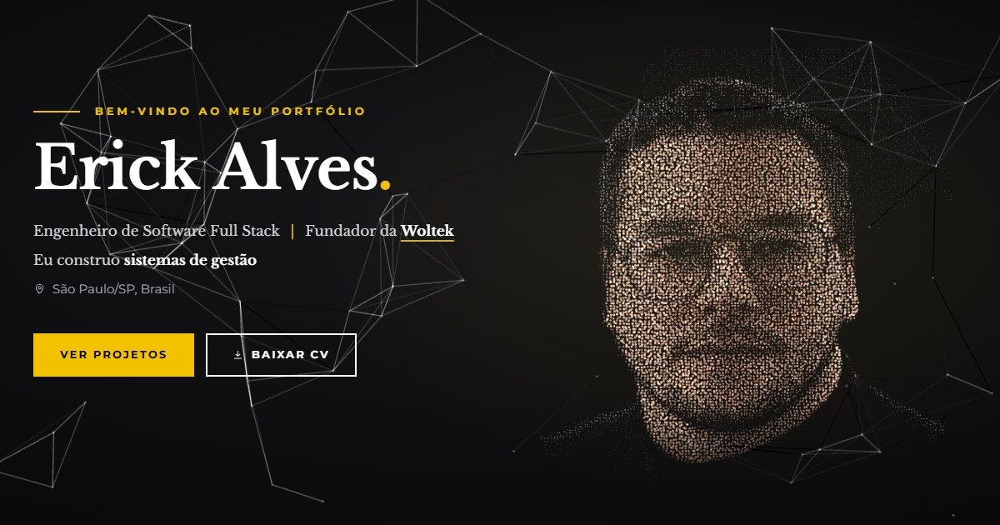

# Erick Alves — portfólio



Portfólio pessoal de Erick Alves, engenheiro de software full stack e fundador da [Woltek](https://woltek.com.br/).

- Retrato em partículas 3D a partir de uma foto, sobre uma rede animada (three.js)
- Projetos, stack, experiência e mapa de contribuições do GitHub
- Animações com anime.js (títulos, filtros, vitrines, diálogos)
- Arcade com quatro jogos em Phaser: Caça-Bugs, Kart Deploy, Funil de Leads e Sonata do Código

## Rodar

Requer Node 22 (veja `.nvmrc`).

```bash
npm install
npm run dev      # http://localhost:5173
npm run build    # gera dist/
```

## Onde fica cada coisa

| Caminho | O quê |
| --- | --- |
| `src/data/portfolio.ts` | Textos, projetos, stack, Woltek e contatos |
| `src/data/contributions.json` | Calendário de contribuições (atualizado pelo workflow) |
| `src/helper/experienceList.ts` | Experiências profissionais |
| `src/components/` | Seções da página |
| `src/games/` | Jogos do arcade (Phaser) e sons sintetizados |
| `public/curriculo.pdf` | Currículo baixado pelos botões "Baixar CV" |

## Publicar

1. Defina `VITE_SITE_URL` com o endereço final, sem barra no final (ex.: `https://erick.woltek.com.br`), nas variáveis de ambiente da hospedagem. Ela preenche o canonical e as tags de compartilhamento (`og:image`).
2. Comando de build `npm run build`; pasta publicada `dist`.

## Mapa de contribuições automático

O workflow `.github/workflows/contribuicoes.yml` roda todo dia e atualiza `src/data/contributions.json`.

1. Crie um token pessoal no GitHub (Settings → Developer settings → Personal access tokens) com o escopo `read:user`.
2. No repositório, em Settings → Secrets and variables → Actions, crie o segredo `CONTRIB_TOKEN` com esse token.
3. Para rodar na hora: aba Actions → "Atualizar contribuições" → Run workflow.

Localmente: `GH_TOKEN=<token> node scripts/update-contributions.mjs`.
